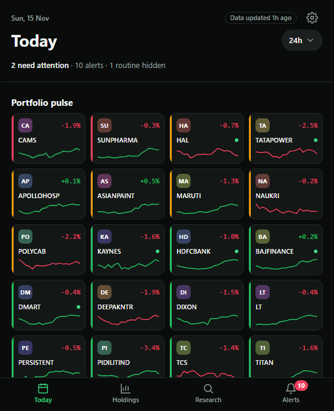
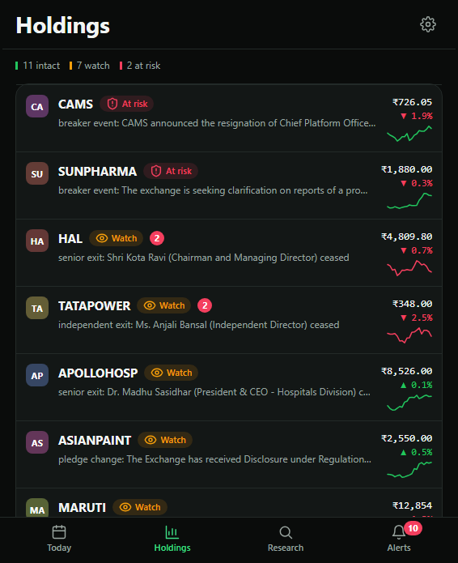
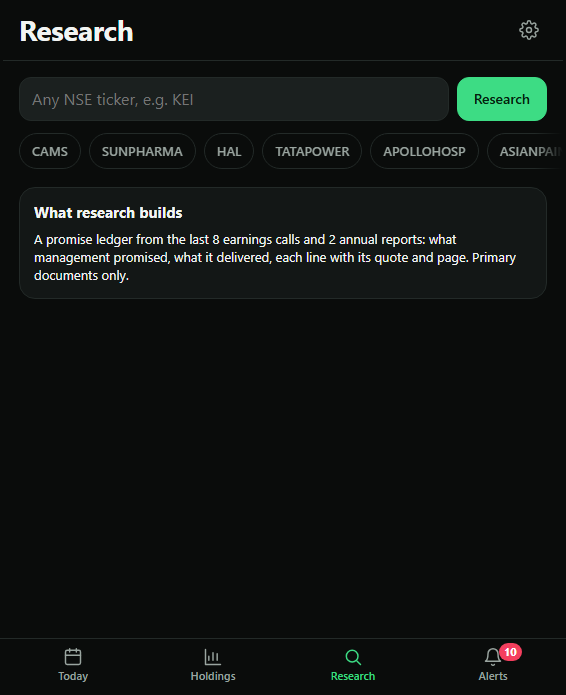
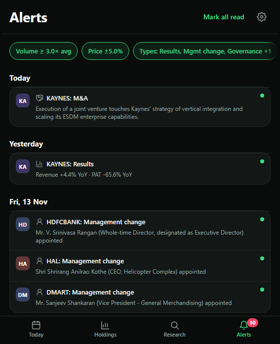
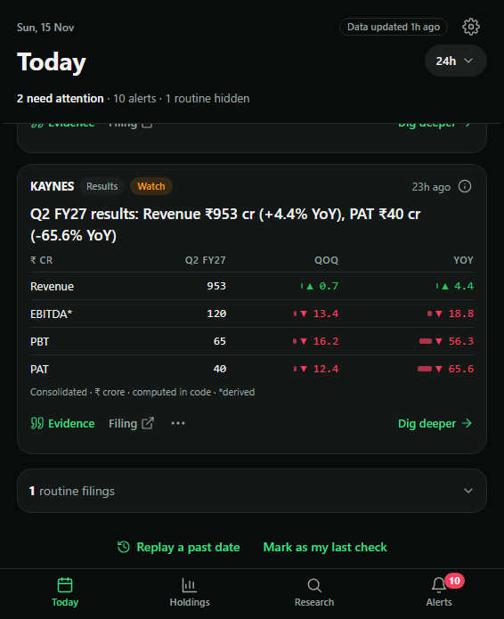
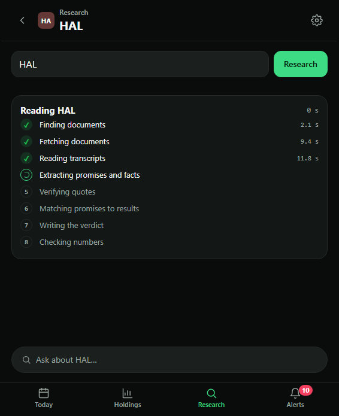
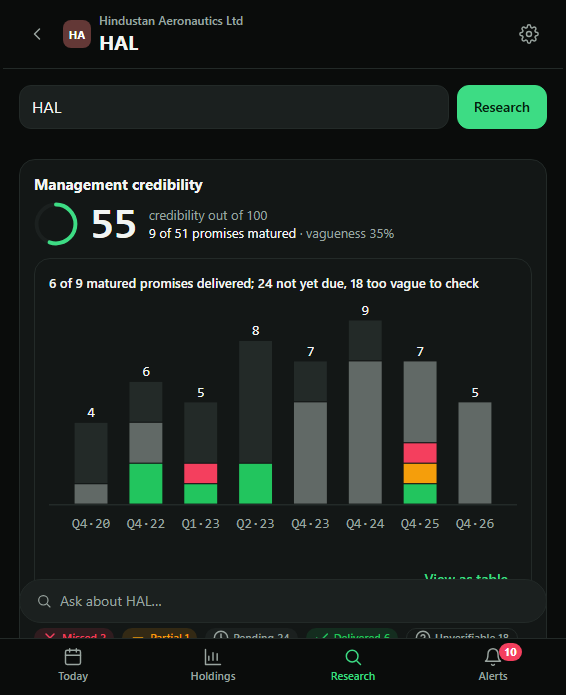
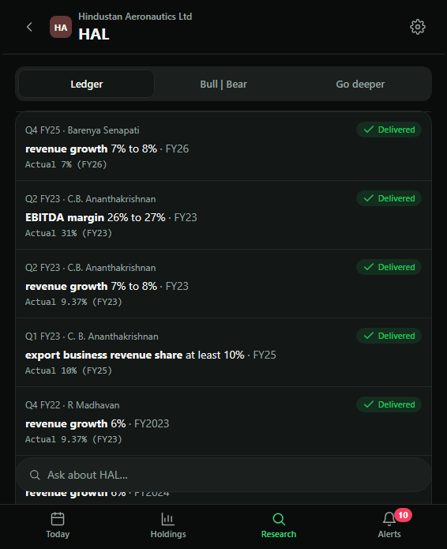
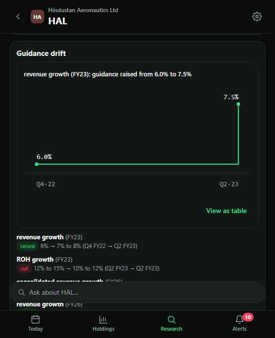

# FINN: has anything happened that changes why I own this?

**Live demo:** https://finn-ypgk.onrender.com  (mobile-first PWA; the free host may take ~30 s to wake on the first visit)

FINN is a decision-support agent for an investor who owns Indian stocks. It watches your portfolio and tells you only what matters (**Push**), and it researches any NSE company from primary documents on demand (**Pull**). It never says buy, sell or hold, and it never places orders.

Built for the ENAM AI Engineer Build Challenge.

| Today | Holdings | Research | Alerts |
|---|---|---|---|
|  |  |  |  |

---

## 1. The problem

A retail or HNI investor with 15–20 stocks cannot read every exchange filing, results release and earnings call. The ones that matter are buried among routine filings, and the useful question is not "what is the price?" but **"has anything happened that changes why I own this?"**

The brief asks for two things:

- **Push:** proactively surface what matters from a portfolio's filings and events, in a digest the user controls, with results summarised properly, management changes explained, and everything else triaged.
- **Pull:** on demand, research any NSE ticker from primary sources only (annual reports and earnings-call transcripts) and show **what management promised versus what it delivered** over recent quarters.

FINN is built around one idea: **a holding is a thesis, and a filing is evidence for or against it.**

## 2. Principles

1. **Python does all the maths. The LLM only reads and writes.** Growth rates, margins, credibility scores and guidance drift are computed in code, and the card says so ("computed in code, *derived").
2. **Every fact carries its source.** Each claim links to a document, page and quote, checked against the source text. If it cannot be verified, it is not shown. Missing data reads "Not in sources", never a guess.
3. **Primary documents only.** Annual reports, earnings-call transcripts and exchange filings. No broker opinions, no news sentiment.
4. **No advice.** No buy, sell or hold language, no price targets, no execution. The About screen states this.
5. **Documents are data, not instructions.** Text inside a filing can never change FINN's behaviour.
6. **Fail soft.** If a source is down, FINN shows the last good copy with a clear notice instead of an error.

## 3. Push: FINN watches for you

### Today: an inbox you can finish


- **Portfolio pulse:** one tile per holding with the day's move and a thesis status bar (**Intact / Watch / At risk**). A dot marks holdings with something new.
- **Needs attention:** only the filings that matter, ranked by priority. Routine filings are folded into one line ("1 routine filings") so the screen can reach zero.
- **Window picker (24h by default):** choose how far back the digest looks. Options include 24h, 3d, 7d, 30d, a custom range, or "since I last checked".
- **Upcoming events strip:** e.g. an analyst/investor meet scheduled for a holding.
- **Replay a past date** and **Mark as my last check** let you rewind the feed or reset your "since I last checked" marker.

### Results cards


Revenue, EBITDA, PBT and PAT for the quarter with **QoQ and YoY** change, in ₹ crore, computed in code. Derived figures are starred. Each card links to **Evidence** (the quote and page), the original **Filing**, and **Dig deeper**. The (i) icon answers "Why am I seeing this?".

### Holdings and thesis status


Each holding has a thesis status that changes when a **breaker event** occurs. Examples visible in the demo: a key management resignation moves CAMS to *At risk*, and a quality-lapse report moves SUNPHARMA to *At risk*. Senior exits, pledge changes and insolvency orders move holdings to *Watch*. You can add or remove holdings by NSE symbol. Removing one hides it from Today and Alerts but keeps its history.

### Alerts


- **Configurable rules:** volume above N× the 20-day average, price move beyond ±N%, and alert types (results, management change, governance, new or dropped promises, peer filings).
- **Price alerts in context:** "up 12.0% (5.5σ), a normal day is ±1.9%, NIFTY +1.7%". A move is judged against the stock's own normal range and the market, not a fixed percent.
- **Volume alerts with numbers:** shares traded vs the average, and rupees traded per day, with a chart on demand.
- **Management-change alerts:** who, what role, appointed or ceased.
- **Peer read-across:** a peer's results flagged against your holding (e.g. a peer's filing → the holding it informs).
- **Delivery:** in-app Alerts tab plus Web Push notifications, with a "Send a test" button. On iPhone, add FINN to the Home Screen first.

## 4. Pull: FINN researches for you


Type any NSE ticker, including companies you do not own, or tap a holding. FINN builds a **promise ledger** from the last 8 earnings calls and 2 annual reports.

### Live pipeline


Eight visible steps with timings: finding documents, fetching documents, reading transcripts, extracting promises and facts, verifying quotes, matching promises to results, writing the verdict, checking numbers.

### Management credibility


A 0–100 credibility score, shown with its basis ("9 of 51 promises matured") and a **vagueness** percentage. The chart shows how many promises were made each quarter and how they resolved: **delivered, partial, missed, pending, unverifiable**. A "View as table" link is on every chart.

### The ledger


Every promise is shown as who said it, when, the target and period, the actual outcome and a verdict. Example from HAL: revenue growth guided at 8% to 10% for FY26 against 7% actual is marked **Missed**. Tabs: **Ledger**, **Bull | Bear**, **Go deeper**.

### Guidance drift


How a target moved across calls, for example revenue-growth guidance raised from 6.0% to 7.5%, with the quarter of each change.

### Business snapshot, named risks and receipt
Plain-language business description and the risks management itself names. Each report ends with a **receipt**: sources used, time taken, cost, and the number of unverified claims (target: 0).

### Ask about this company
An "Ask about HAL…" bar answers questions using only that company's sources, with citations.

## 5. How it works

```
 BSE / NSE filings ─┐
 Earnings calls     ├─► ingest (multi-source, circuit breaker) ─► Postgres
 Annual reports    ─┘                                              │
 Prices (yfinance → bhavcopy fallback)                             ▼
                                         classify & extract ─► verify (quote + page match)
                                                                   │
                                  Python computes: QoQ/YoY, credibility, drift, alerts
                                                                   │
                                                                   ▼
                                   FastAPI ─► installable mobile PWA + Web Push
```

- **Ingest:** scheduled runs with fallbacks per source, a circuit breaker, and a visible "Data updated … ago" status. If a source fails, the app shows the last good copy.
- **Extraction:** the LLM reads documents and returns structured JSON. Quotes are fuzzy-matched back to the page text, and anything that does not match is dropped.
- **Scoring:** credibility is recency-weighted and only counts matured, verifiable promises. Vague promises are reported separately rather than counted as misses.
- **Cost and speed:** cheap model for classification, stronger model for research, responses cached by input hash. A research run in the demo took about 56 s and cost about $0.03.

**Stack:** Python, FastAPI, Postgres (Neon), Gemini models behind one router, an installable web app with Web Push, hosted on Render.

## 6. Demo portfolio

20 NSE holdings across banks and financials, IT, consumer, industrials, defence, electronics, pharma/healthcare and auto, plus research-only companies to test Pull on stocks you don't own.

## 7. Run locally

```bash
git clone https://github.com/Vaibhav0056/ENAM-Holdings.git && cd ENAM-Holdings
python -m venv .venv && source .venv/bin/activate     # Windows: .venv\Scripts\activate
pip install -r requirements.txt
cp .env.example .env        # set DATABASE_URL, DATABASE_URL_UNPOOLED and GEMINI_API_KEY
python tasks.py setup       # migrate the database, then seed companies and alert rules
python tasks.py serve       # or: uvicorn api:app --port 8000
```

Open http://localhost:8000. `python tasks.py test` runs the unit tests and `python -m evals.run` the evaluations.

## 8. Design

- **Icons:** [Lucide](https://lucide.dev) (ISC licence, in `vendor/lucide/LICENSE`), shipped as one inline SVG sprite (`static/icons.svg`, about 7 KB) with only the icons FINN uses. They are drawn in `currentColor` with a 1.75 stroke at 16, 20 or 24 px. Each alert type has its own icon (results, management change, governance, M&A, volume, price up or down, peer read-across, promises, insolvency). Thesis status and promise verdicts always show an icon together with the text label and colour.
- **Company logos:** FINN shows a logo from `static/logos/<SYMBOL>.svg|png|webp` when one is bundled. Otherwise it shows a **monogram tile**: the first two letters of the symbol on a muted colour derived from the symbol. Every company, including ones you add later and research-only tickers, always has a mark, and there are never broken images. No logo is downloaded from the web (see `static/logos/README.txt`).
- **Small visuals:** 30-day price sparklines on the pulse tiles and holdings rows, small QoQ/YoY bars on results cards, and a ring next to the credibility score. All are inline SVG built from FINN's own stored data, and each keeps a text equivalent.
- **No external requests:** the app loads nothing from third-party hosts at runtime (no CDNs, web fonts or hotlinked images). Everything is served from FINN's own origin, so it renders fully with all third-party traffic blocked.

## 9. Limits (stated honestly)

- Decision support only. Not investment advice.
- Coverage depends on what exchanges publish. Image-only PDFs may not be readable, and those items are labelled rather than guessed.
- Promises with no measurable target are shown as "unverifiable" and excluded from the credibility score.
- Free-tier hosting can cold-start; a keep-awake ping is used during evaluation.

## 10. Credits

UI components adapted from free MIT-licensed kits (Pines, HyperUI, TailAdmin); icons from Lucide (ISC). Licences are in `vendor/`.

Company names and logos belong to their respective owners and are used only to identify the companies.
